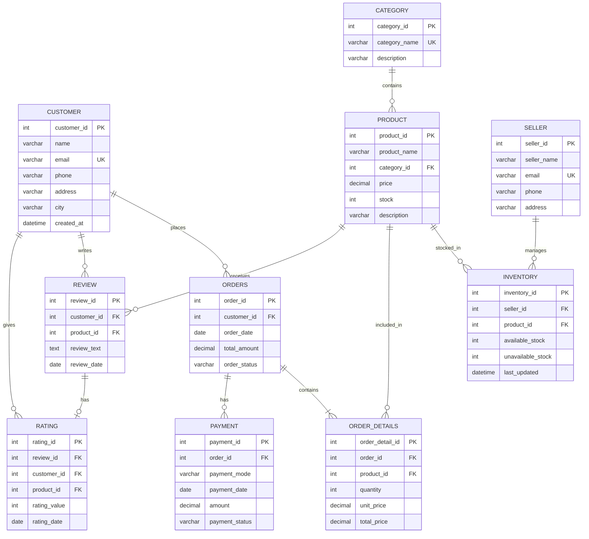

# Task XV — ER Diagram

This ER diagram represents the tables and foreign-key relationships in the E-Commerce Intelligence Platform. It uses Mermaid, so GitHub can render the diagram directly.

## Relationship Summary

- One customer can place many orders.
- One category can contain many products.
- Sellers and products are connected through inventory records.
- One order contains one or more order-detail records; each detail refers to a product.
- An order can have multiple payment records.
- Customers can review products. Each review can have one rating record.
- Ratings also reference the customer and product.

**Key:** PK = Primary Key, FK = Foreign Key, UK = Unique Key.
